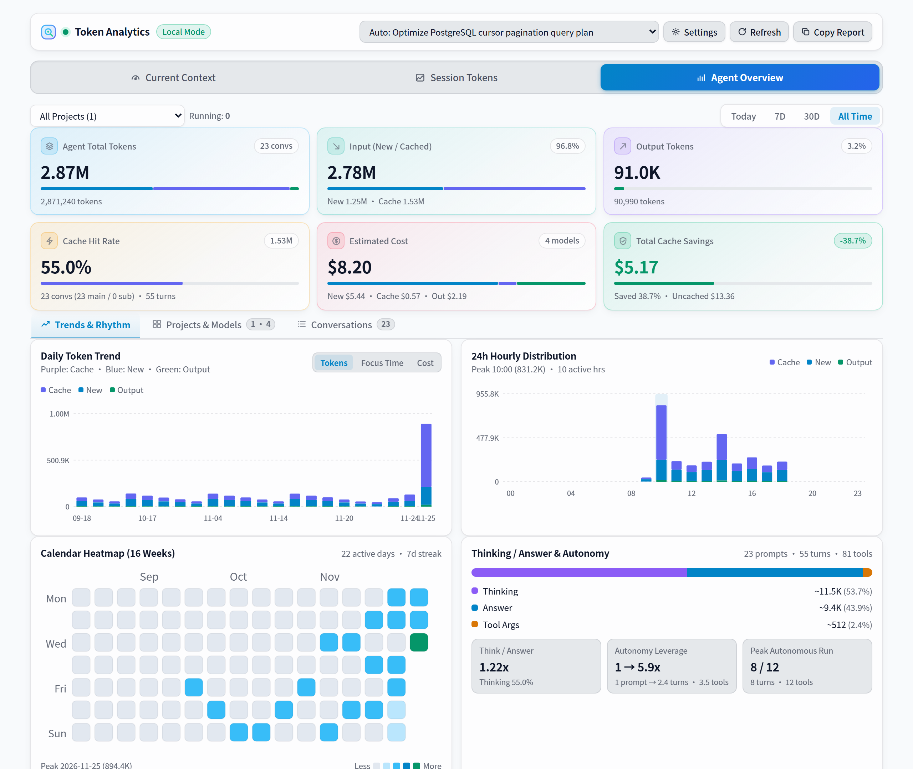
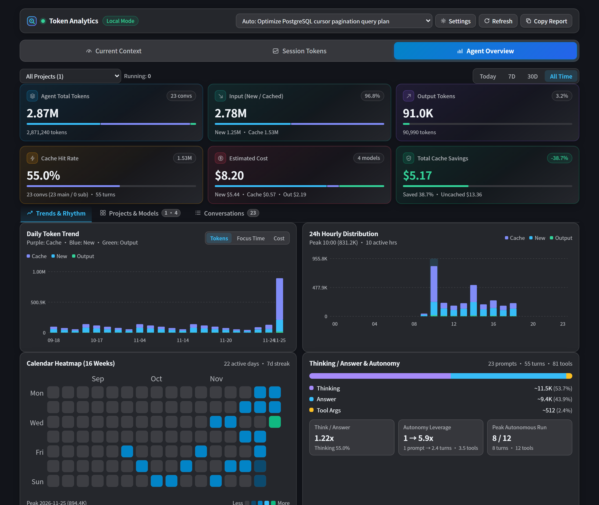
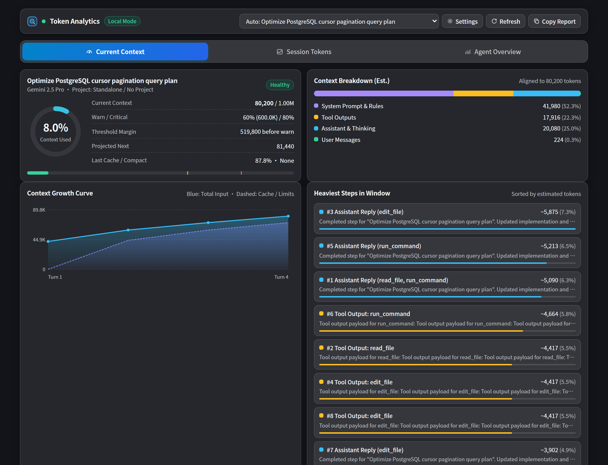
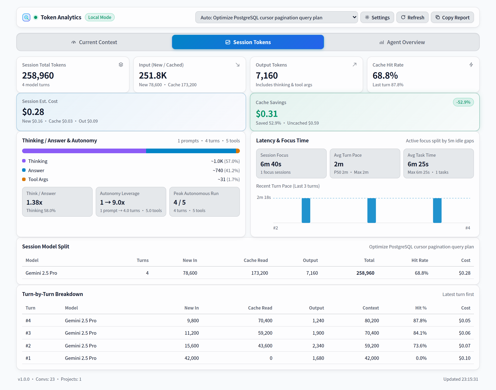

# Token Analytics

[简体中文](./README.md) | [English](./README.en.md)

[](./LICENSE)
[](#privacy--architecture)
[](https://nodejs.org/)
[](https://github.com/dbg4win/token-analytics/actions/workflows/ci.yml)

A native, **zero-dependency, non-intrusive** Antigravity Sidecar UI plugin to inspect your AI coding sessions: **context window saturation**, **token & prompt-cache economics**, **thinking/autonomy leverage**, and **agent-wide activity & focus duration**.

> [!NOTE]
> **Design Philosophy**
> For most developers, the need is simple: occasionally checking how much context window is used and how many tokens a project has consumed—without constant background polling or heavy live computation. Following a purely passive, non-intrusive philosophy, **Token Analytics** hooks into zero runtime execution paths, modifies zero host state, and derives every metric solely from data Antigravity already saves locally.

---

## Screenshots

### Agent Overview — Light & Dark Themes

6 color-coded KPI cards (`3 × 2` responsive grid), range & project filters, and organized sub-tabs for **Trends & Rhythm**, **Projects & Models**, and searchable/sortable **Conversations**:

| Light Theme | Dark Theme |
| :---: | :---: |
|  |  |

### Current Context & Session Tokens

| Current Context (Dark) | Session Tokens (Light) |
| :---: | :---: |
|  |  |

---

## Features

### 1. Current Context (`当前上下文`)
- **Context Saturation Gauge**: Real-time context usage (`input_tokens + cache_read_tokens`) vs. model context ceiling, with next-turn projection and health status badge (`Healthy` / `Warn` / `Critical`).
- **Custom Alert Thresholds**: Persist global warning & critical alerts either by window percentage (`%`) or absolute token count, complete with quick presets.
- **4-Bucket Composition Breakdown**: Estimates proportional token weight across **System Prompts & Rules**, **Tool Outputs**, **Assistant & Thinking**, and **User Messages**.
- **Compaction Detection & Growth Curve**: Detects context compaction drops automatically, plots per-turn context trajectory with threshold markers, and ranks the heaviest steps in the active window.

### 2. Session Tokens (`会话 Token`)
- **Session Cost & Prompt Cache Savings**: Tracks New Input, Cache Read, Output Tokens, Cache Hit Rate, estimated USD/CNY API cost, and cumulative Prompt Cache savings.
- **Thinking / Answer Mix & Autonomy Leverage**: Estimates thinking tokens vs. formal answers & tool arguments, plus `1 prompt -> N turns / tools` autonomy leverage and peak autonomous run.
- **Latency & Focus Duration**: Tracks turn response pace (`Avg / P50 / Max`), average task duration, and 5-minute idle-gap focus duration.
- **Subagent Rollup & Turn Table**: Aggregates spawned subagent tokens alongside the parent session, splits usage by model, and copies one-click Markdown reports.

### 3. Agent Overview (`Agent 全局用量`)
- **6 Distinct Color-Coded KPI Cards** (`3 × 2` desktop / `2 × 3` side pane) with proportional micro-bars:
  1. **Agent Total Tokens**
  2. **Input (New / Cached)**
  3. **Output Tokens**
  4. **Cache Hit Rate**
  5. **Estimated Cost**
  6. **Total Cache Savings**
- **Time & Project Filters**: Filter metrics by `Today` / `7D` / `30D` / `All Time` and scope by project.
- **3 Underline Sub-Tabs**:
  - **Trends & Rhythm**: Interactive Daily Trend (`Tokens` / `Focus Time` / `Cost`), 24h Hourly Distribution, 16-week Calendar Heatmap, Thinking/Autonomy summary, and Daily Focus Time chart.
  - **Projects & Models**: Project share bar, click-to-filter project table, and per-model token/cost/savings breakdown.
  - **Conversations**: Real-time search by title/project/model, sortable columns (`Total`, `Cost`, `Context`), and click-to-inspect jumping straight into any session.

### 4. Ergonomics & Customization
- **Host Theme & Agent Font Sync**: Mirrors Antigravity light/dark palette variables in real time and defaults to `Follow Agent` typography (or switch manually between `Google Sans`, `Noto Sans SC`, `PingFang / YaHei`, `JetBrains Mono`, and `System UI`).
- **Bilingual UI (`English` / `中文`)**: One-click switch in Settings, persisted globally (supports `?lang=en|zh`, `?theme=light|dark`, `?tab=context|session|agent`, `?subtab=trends|breakdown|conversations`).
- **Custom Model Pricing**: Built-in API baseline rates with per-model overrides and live `USD` / `CNY` currency conversion.

---

## Privacy & Architecture

- **100% Local Execution**: Reads only your local Antigravity transcripts (`${ANTIGRAVITY_APP_DATA_DIR:-~/.gemini/antigravity}/brain/<id>/.system_generated/logs/transcript.jsonl`), local project metadata, and the local loopback Antigravity Language Server API.
- **Zero External Requests & Zero Telemetry**: Never sends any data over the network. No analytics trackers, no third-party APIs, no CDN scripts.
- **Zero Dependencies**: Built purely with Node.js built-in modules (`node:http`, `node:fs`, `node:path`, `node:crypto`, `node:os`) and self-contained HTML/CSS/SVG/JS. Compatible with Node.js 22+ (tested on Node 22 & 24).

---

## Installation

1. Copy or clone this repository into `~/.gemini/config/plugins/token-analytics/`:
   - **macOS / Linux**:
     ```bash
     git clone https://github.com/dbg4win/token-analytics.git ~/.gemini/config/plugins/token-analytics
     ```
   - **Windows (PowerShell)**:
     ```powershell
     git clone https://github.com/dbg4win/token-analytics.git "$env:USERPROFILE\.gemini\config\plugins\token-analytics"
     ```
2. Open the **Plugins** manager in Antigravity, locate **Token Analytics**, and enable both the plugin and its `token_analytics` sidecar.
3. Open the panel:
   - **Side Pane (`AUX_PANE`)**: Click **`+`** in the right auxiliary pane and select **Token Analytics**.
   - **Full Dashboard (`SIDEBAR`)**: Open **Plugins > Token Analytics** in the left navigation bar.

---

## Standalone Mode & Testing

Run the built-in loopback server without Antigravity for local development or UI preview:

```bash
npm run dev
# Opens at http://127.0.0.1:17910/ (side pane) or http://127.0.0.1:17910/full (full dashboard)
```

Run the offline verification suite (uses isolated mock transcript fixtures, safe for CI):

```bash
npm test
```

Optionally verify against live local transcripts in `~/.gemini/antigravity`:

```bash
npm run test:live
```

---

## Project Structure

```text
token-analytics/
├── .github/workflows/ci.yml             # Cross-platform CI (Node 22 & 24)
├── assets/logo.svg                      # Vector plugin icon
├── docs/screenshots/                    # Light & dark sanitized UI screenshots
├── sidecars/token_analytics/
│   ├── main.mjs                         # Sidecar & standalone HTTP server entrypoint
│   ├── sidecar.json                     # Antigravity sidecar manifest
│   ├── lib/
│   │   ├── collector.mjs                # Incremental transcript & LS metadata collector
│   │   ├── metrics.mjs                  # Token, context, efficiency & timing engine
│   │   ├── pricing.mjs                  # Model rate matching & cache savings math
│   │   ├── settings.mjs                 # Persisted thresholds, pricing, lang & font store
│   │   └── ui.mjs                       # Self-contained bilingual SVG/CSS/JS dashboard
│   └── test/verify.mjs                  # Unit, offline fixture & HTTP server test suite
├── skills/token-analytics/SKILL.md      # Agent skill metadata
├── plugin.json                          # Plugin manifest
├── package.json
├── CHANGELOG.md
└── LICENSE                              # MIT License
```

---

## License

[MIT](./LICENSE) © [dbg4win](https://github.com/dbg4win)
