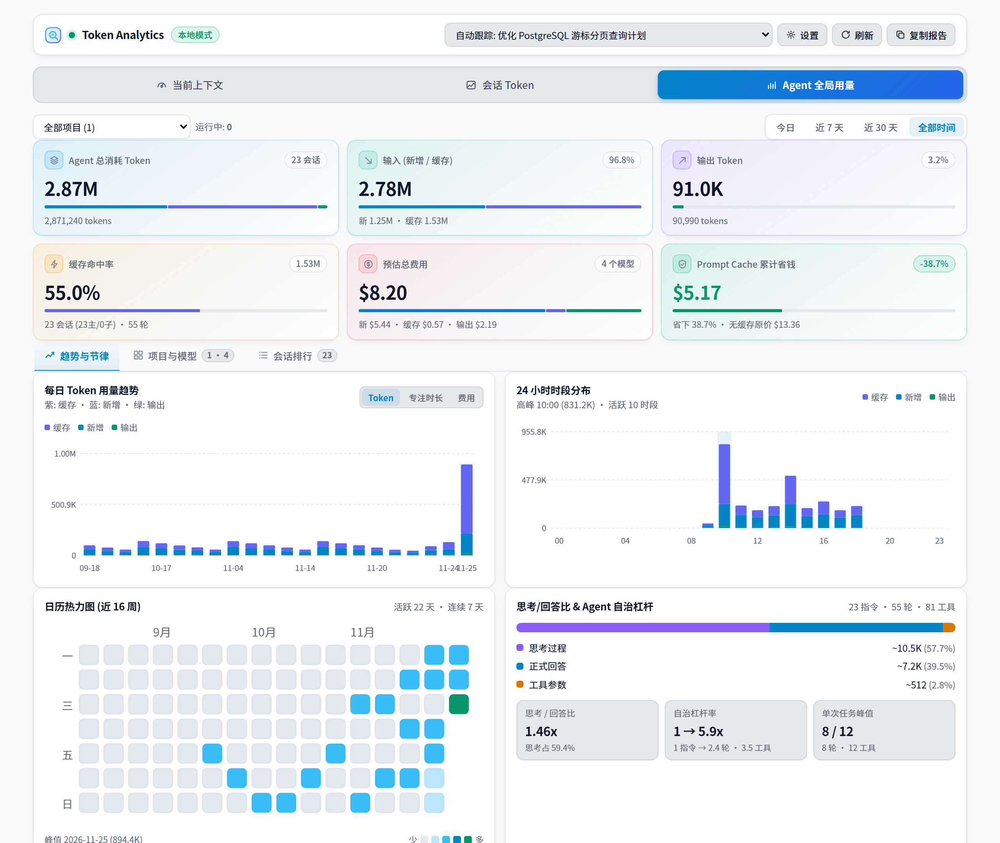
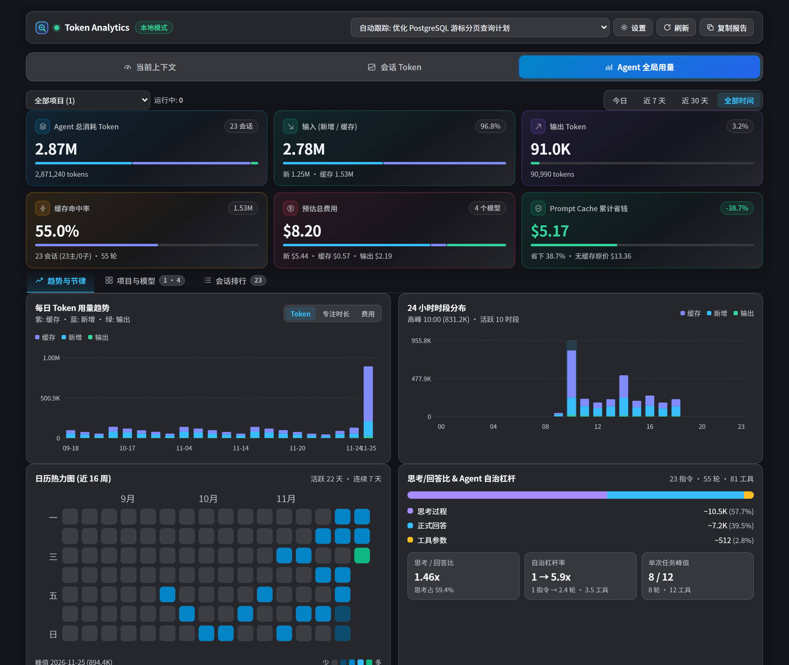
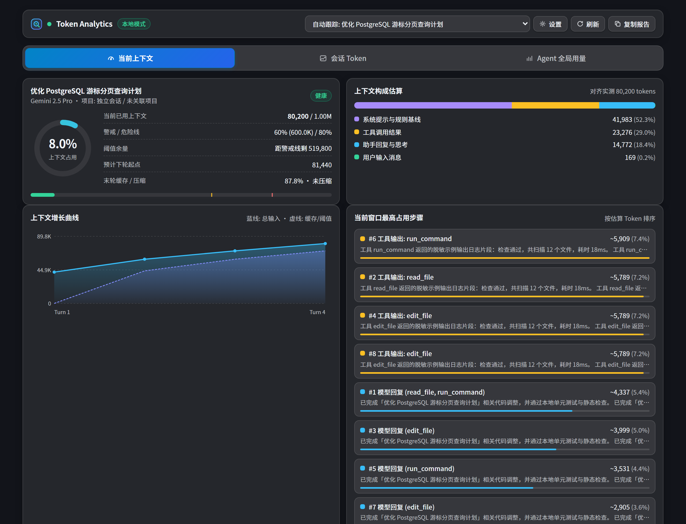
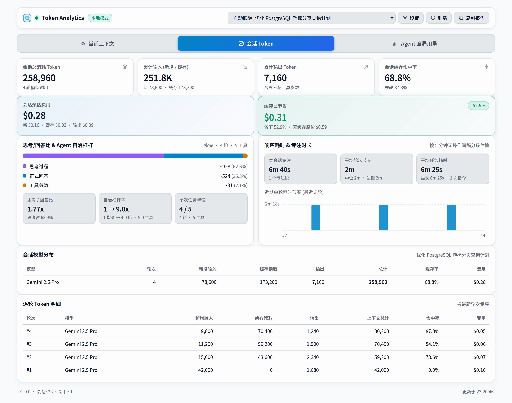

# Token Analytics

[简体中文](./README.md) | [English](./README.en.md)

[](./LICENSE)
[](#隐私与架构)
[](https://nodejs.org/)
[](https://github.com/dbg4win/token-analytics/actions/workflows/ci.yml)

一款原生集成于 Antigravity 的**零依赖、零侵入** Sidecar UI 插件，用于随时查看：**当前会话上下文水位**、**Token 与 Prompt Cache 成本节省**、**思考比与自治杠杆**，以及 **Agent 全局活跃节律与专注时长**。

> [!NOTE]
> **设计理念**
> 其实很多人的诉求很简单，只是偶尔看一看当前上下文用了多少、整体项目累计消耗了多少 Token，并不需要持续实时更新或重计算。因此本项目坚持**纯静态读取、非侵入式**的设计理念——不拦截运行时链路、不修改宿主任何文件或状态，所有数据均直接来自 Antigravity 自身在本地已经保存的数据。

---

## 界面预览

### Agent 全局用量 — 浅色 & 深色主题

顶部 **6 张专属渐变色彩 KPI 卡片**（`3 × 2` 自适应网格），搭配时间与项目筛选以及 **趋势与节律 / 项目与模型 / 会话排行** 3 个子标签页：

| 浅色主题（Light） | 深色主题（Dark） |
| :---: | :---: |
|  |  |

### 当前上下文 & 会话 Token

| 当前上下文（深色） | 会话 Token（浅色） |
| :---: | :---: |
|  |  |

---

## 核心功能

### 1. 当前上下文（Current Context）
- **上下文水位仪表盘**：实时统计 `input_tokens + cache_read_tokens` 占模型窗口上限的比例，展示下一轮预估与健康状态徽章（`健康` / `警戒` / `危险`）。
- **自定义警戒线**：支持按 **窗口百分比（`%`）** 或 **绝对 Token 数** 设置警戒线与危险线，内置快捷预设并全局持久保存。
- **4 类构成拆解**：直观估算 **系统提示词/规则**、**工具输出**、**助手与思考**、**用户输入** 的 Token 占比。
- **自动压缩检测与增长曲线**：识别 Compaction 事件并绘制带阈值标记的上下文曲线，同时按占用体积列出当前窗口 Top 步骤。

### 2. 会话 Token（Session Tokens）
- **费用与缓存省钱估算**：统计新增输入、缓存读取、输出 Token、缓存命中率、预估 API 费用与 Prompt Cache 累计省钱（支持 `USD` / `CNY` 与分模型自定义单价）。
- **思考/回答比 & Agent 自治杠杆**：估算思考内容、正式回答与工具参数占比，计算 `1 指令 -> N 轮 / 工具` 杠杆率与单次任务峰值。
- **响应耗时 & 专注时长**：展示轮次耗时柱图（平均 / P50 / 最慢）、平均任务耗时，以及按 5 分钟无操作间隔估算的专注时长。
- **子 Agent 汇总与逐轮明细**：合并统计派生子会话用量，按模型拆分统计，并支持一键复制 Markdown 统计报告。

### 3. Agent 全局用量（Agent Overview）
- **6 张彩色主题 KPI 卡片**（宽屏 `3 × 2` / 侧边栏 `2 × 3`，带比例微条）：
  1. **Agent 总消耗 Token**
  2. **输入（新增 / 缓存）**
  3. **输出 Token**
  4. **缓存命中率**
  5. **预估总费用**
  6. **Prompt Cache 累计省钱**
- **多维度筛选**：支持 `今日 / 近 7 天 / 近 30 天 / 全部时间` 与按项目过滤。
- **3 个子标签页分层查看**：
  - **趋势与节律**：支持在 `Token / 专注时长 / 费用` 之间切换的每日趋势图、24 小时时段分布、近 16 周日历热力图、思考/自治杠杆以及每日专注时长。
  - **项目与模型**：项目占比分布条、点击行筛选的项目明细表，以及各模型用量、费用与省钱汇总。
  - **会话排行**：支持按会话标题、项目或模型关键词实时搜索，支持多列排序（总计 / 费用 / 上下文）并点击直接跳转查看。

### 4. 外观同步与双语体验
- **主题与 Agent 字体同步**：实时跟随 Antigravity 明暗主题配色；界面字体默认**跟随 Agent**，也可手动切换 `Google Sans`、`Noto Sans SC`、`微软雅黑 / PingFang`、`JetBrains Mono` 或系统字体。
- **中英双语切换**：在设置中一键切换 **中文 / English** 并持久保存；独立模式下还支持通过 URL 参数指定（`?lang=zh|en`、`?theme=light|dark`、`?tab=context|session|agent`、`?subtab=trends|breakdown|conversations`）。

---

## 隐私与架构

- **100% 本地运行**：仅读取本机会话日志（`${ANTIGRAVITY_APP_DATA_DIR:-~/.gemini/antigravity}/brain/<id>/.system_generated/logs/transcript.jsonl`）、本地项目元数据及本机回环 Antigravity Language Server 接口。
- **零外网请求、零遥测上报**：不向任何外部服务器发送数据，无统计埋点、无第三方 API 调用、无 CDN 资源加载。
- **零第三方依赖**：完全使用 Node.js 内置模块与自包含 HTML/CSS/SVG/JS 构建，兼容 Node.js 22+（推荐 Node.js 24+）。

---

## 安装方法

1. 将本仓库复制或克隆到 `~/.gemini/config/plugins/token-analytics/`：
   - **Windows (PowerShell)**：
     ```powershell
     git clone https://github.com/dbg4win/token-analytics.git "$env:USERPROFILE\.gemini\config\plugins\token-analytics"
     ```
   - **macOS / Linux**：
     ```bash
     git clone https://github.com/dbg4win/token-analytics.git ~/.gemini/config/plugins/token-analytics
     ```
2. 打开 Antigravity 的 **Plugins** 插件管理器，找到 **Token Analytics**，启用插件并开启 `token_analytics` Sidecar。
3. 打开界面：
   - **侧边栏面板（Aux Pane）**：点击右侧辅助面板 **`+`** 按钮选择 **Token Analytics**。
   - **全屏仪表盘（Sidebar）**：在左侧导航栏点击 **Plugins > Token Analytics**。

---

## 独立调试与测试

不依赖宿主即可启动内置回环 HTTP 服务器：

```bash
npm run dev
# 访问 http://127.0.0.1:17910/（侧栏视图）或 http://127.0.0.1:17910/full（全屏视图）
```

运行离线自动化测试套件（使用隔离 Mock 会话数据，CI 可直接运行）：

```bash
npm test
```

如需同时验证本机 `~/.gemini/antigravity` 下的真实会话采集：

```bash
npm run test:live
```

---

## 目录结构

```text
token-analytics/
├── .github/workflows/ci.yml             # 跨平台 GitHub Actions CI（Node 22 & 24）
├── assets/logo.svg                      # 插件矢量图标
├── docs/screenshots/                    # 浅色 & 深色脱敏界面截图
├── sidecars/token_analytics/
│   ├── main.mjs                         # Sidecar 与独立模式 HTTP 入口
│   ├── sidecar.json                     # Antigravity Sidecar 清单
│   ├── lib/
│   │   ├── collector.mjs                # 增量日志与 Language Server 元数据采集器
│   │   ├── metrics.mjs                  # Token、上下文、效率杠杆与耗时计算引擎
│   │   ├── pricing.mjs                  # 模型单价匹配与 Cache 省钱计算
│   │   ├── settings.mjs                 # 阈值、单价、语言与字体持久化存储
│   │   └── ui.mjs                       # 自包含双语 SVG/CSS/JS 仪表盘界面
│   └── test/verify.mjs                  # 单元测试、离线 Mock 与 HTTP 服务测试
├── skills/token-analytics/SKILL.md      # Agent Skill 描述
├── plugin.json                          # 插件清单
├── package.json
├── CHANGELOG.md
└── LICENSE                              # MIT 开源协议
```

---

## 开源协议

[MIT](./LICENSE) © [dbg4win](https://github.com/dbg4win)
